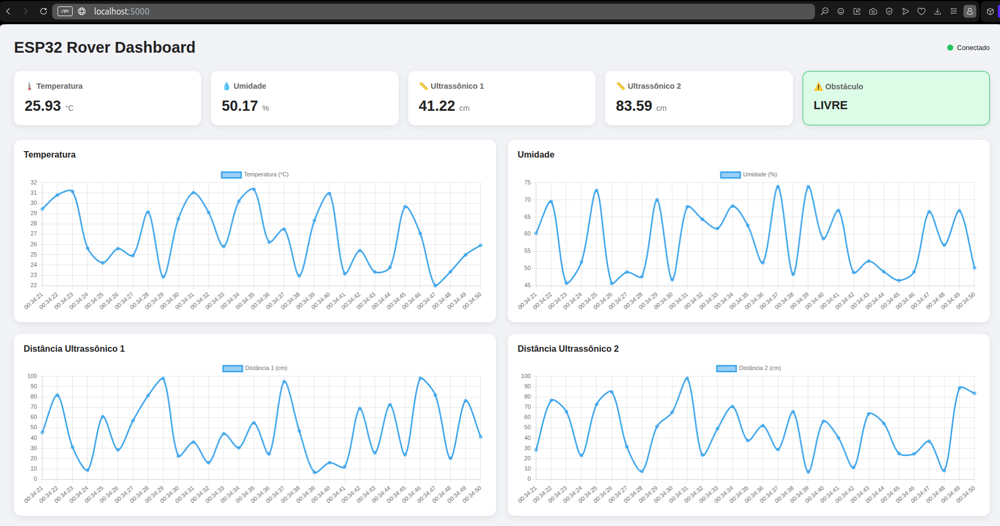

# ESP32 Rover Monitor — monitoramento de sensores

Projeto acadêmico para ler temperatura, umidade e distância no ESP32, transmitir as leituras por Bluetooth Low Energy (BLE) e exibi-las em um dashboard web. O backend recebe os dados por HTTP, grava um histórico em CSV e publica atualizações em tempo real via Socket.IO.

O dashboard também pode ser usado sem o ESP32: um simulador Python envia leituras fictícias ao backend.

## Dashboard



## Arquitetura atual

```text
ESP32 (esp.c) ── BLE ──> cliente Python (client/) ── HTTP ──┐
                                                            v
Simulador (monitor/) ───────────────────────────────────> Flask (monitor/)
                                                           ├── sensors.csv
                                                           └── Socket.IO ──> navegador
```

O simulador e o cliente BLE são fontes alternativas de dados. O simulador não é iniciado automaticamente pelo servidor. O cliente BLE e o firmware estão no projeto, mas dependem do ESP32 e do hardware configurados para funcionar.

## Estrutura do projeto

```text
esp32-rover-monitor/
├── esp.c                       # Firmware Arduino para o ESP32
├── client/
│   ├── client.py                # Recebe notificações BLE e as envia por HTTP
│   ├── scan_ble.py              # Procura o ESP32 anunciado por BLE
│   ├── test_ble.py              # Testa conexão e notificações BLE
│   └── requirements.txt
└── monitor/
    ├── app.py                  # Backend Flask, API, CSV e Socket.IO
    ├── simulator.py            # Gera leituras fictícias e chama a API
    ├── requirements.txt
    └── templates/index.html    # Dashboard
```

O arquivo `sensors.csv` é criado no diretório de trabalho do backend quando chega a primeira leitura. Para mantê-lo em `monitor/`, execute os comandos a partir desse diretório.

## Requisitos

- Python 3.10 ou superior e `pip`;
- navegador moderno;
- para BLE: adaptador Bluetooth compatível e ESP32 com o firmware carregado;
- para compilar o firmware: Arduino IDE ou outro ambiente com suporte à placa ESP32, além das bibliotecas `DHT sensor library` e `ESP32 BLE Arduino` compatíveis com o core instalado.

## Executar usando dados simulados

Abra um terminal na raiz do repositório e prepare o backend:

```bash
cd monitor
python3 -m venv .venv
source .venv/bin/activate
pip install -r requirements.txt
```

O arquivo `monitor/requirements.txt` inclui as dependências do backend e do simulador. As versões de `Flask-SocketIO` e `requests` estão fixadas para tornar a instalação reproduzível.

Inicie o servidor no primeiro terminal:

```bash
python app.py
```

Em outro terminal, inicie o simulador:

```bash
cd monitor
source .venv/bin/activate
python simulator.py
```

Abra <http://localhost:5000>. O simulador envia temperatura, umidade, duas distâncias e estado de obstáculo aproximadamente uma vez por segundo. Para parar cada processo, use `Ctrl+C` no terminal correspondente.

## Executar com ESP32

1. Carregue `esp.c` no ESP32 com as bibliotecas e a placa configuradas. O firmware anuncia o dispositivo como `ESP32-SENSOR`, com serviço BLE `4fafc201-1fb5-459e-8fcc-c5c9c331914b` e característica `beb5483e-36e1-4688-b7f5-ea07361b26a8`.
2. Inicie o backend como descrito acima. Não inicie o simulador ao mesmo tempo, a menos que queira misturar leituras simuladas e reais no mesmo histórico e dashboard.
3. Em outro terminal, instale e execute o cliente:

   ```bash
   cd client
   python3 -m venv .venv
   source .venv/bin/activate
   pip install -r requirements.txt
   python client.py
   ```

O cliente procura o dispositivo, recebe notificações BLE contendo JSON e envia os campos recebidos para `http://127.0.0.1:5000/api/sensors`. O dashboard deve ser aberto no mesmo computador do backend. Para testar apenas a descoberta BLE, use `python scan_ble.py`; `python test_ble.py` tenta conectar e aguarda notificações por 30 segundos.

No Windows, ative o ambiente virtual com `.venv\Scripts\activate` em vez de `source .venv/bin/activate`. Os comandos `python3` podem ser substituídos por `python`, conforme a instalação.

## API e dados

- `GET /api/sensors?limit=100&offset=0`: retorna uma página do histórico em JSON, em ordem cronológica. `limit` aceita de 1 a 1000 registros (padrão: 100); `offset` seleciona páginas anteriores a partir do registro mais recente (padrão: 0; máximo: 10000). Por exemplo, `limit=100&offset=100` retorna os 100 registros imediatamente anteriores à página mais recente.
- `POST /api/sensors`: recebe uma leitura JSON, acrescenta o timestamp no servidor, grava no CSV e emite o evento Socket.IO `sensor_data`. Retorna HTTP `201` em caso de sucesso.

Exemplo de corpo aceito:

```json
{
  "temperature": 27.4,
  "humidity": 63.2,
  "distance1": 35.1,
  "distance2": 18.7,
  "obstacle": true
}
```

Temperatura, umidade e distâncias podem ser `null` quando uma leitura não estiver disponível. O dashboard mostra os valores atuais e gráficos com até 30 pontos recentes por sensor. O CSV mantém as leituras recebidas entre execuções.

## Tecnologias

- Firmware: C++ para ESP32, BLE, sensor DHT e sensores ultrassônicos;
- cliente: Python, Bleak e Requests;
- backend: Python, Flask e Flask-SocketIO;
- dashboard: HTML, JavaScript, Chart.js e Socket.IO;
- histórico: CSV.
